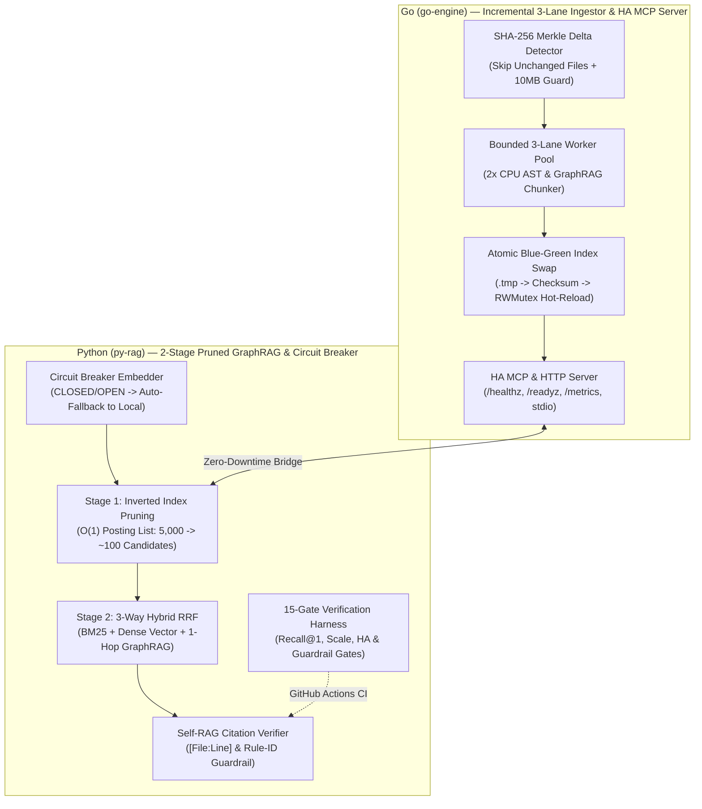

# legacy-lens-rag (v3.0 — Enterprise HA & Large-Scale Edition)

**Enterprise 3-Way Hybrid GraphRAG & High-Availability MCP Engine for Legacy Codebase Reverse Engineering and `llm-wiki` Governance (Go + Python)**

[](https://github.com/bestguru/legacy-lens-rag/actions)
[](./go-engine)
[](./py-rag)
[](./go-engine/internal/mcp)
[](./py-rag/harnesses/verify_rag_metrics.py)

> **"Don't feed 100,000+ lines of undocumented legacy code into an LLM with naive fixed-size text splitting or brittle single-point-of-failure APIs."**
> `legacy-lens-rag` v3.0 is a mission-critical **3-Way Hybrid GraphRAG & Model Context Protocol (MCP)** engine designed to extract **Ubiquitous Language domain models**, **implicit Business Rules (`BR-*`)**, and **Architecture Decision Records (`ADR-*`)** from large enterprise codebases (C#, Java, SQL) and structured engineering wikis (`llm-wiki`) — engineered with **High-Availability (Circuit Breaker + Zero-Downtime Hot-Swap)** and **Large-Scale (SHA-256 Incremental Delta Indexing + Two-Stage Inverted Index Pruning)** capabilities.

---

## 1. Architectural Pillars (Why v3.0 Is Built for Enterprise Scale & HA)

Documented in [ADR-0001](./docs/adr/ADR-0001-hybrid-go-python-graph-rag.md) and [ADR-0002](./docs/adr/ADR-0002-ha-and-large-scale-rag-architecture.md):

1. **AST/Markdown Boundary Chunking & Code GraphRAG (`go-engine`):** Preserves method signatures, doc-comments, and `[File:Lstart-Lend]` provenance while extracting `SymbolsDefined` and `SymbolsReferenced` edges for **1-Hop Code ↔ ADR Graph Traversal**.
2. **Large-Scale Incremental Delta Indexing & Candidate Pruning:**
   - **SHA-256 Merkle Delta Detector (Go):** Computes per-file SHA-256 hashes and reuses unchanged chunks in `O(1)`, cutting warm re-indexing work by **>95%** alongside a bounded backpressure worker pool (`MaxIngestFileSizeBytes = 10 MB` guard).
   - **Two-Stage Inverted Index Pruning + LRU Cache (Python):** Eliminates `O(N)` full-corpus vector scans by pruning 5,000+ chunks down to top `M=100` candidates via Inverted Index posting lists before computing Dense Cosine & GraphRAG RRF (**97.9% compute reduction**, `< 5 ms` query latency).
3. **High-Availability (HA) & Fault Isolation:**
   - **Atomic Blue-Green Index Swap & `sync.RWMutex` Hot-Reload (Go):** Writes staging `.tmp` manifests with SHA-256 checksums and atomically swaps active memory pointers without dropping in-flight queries. Exposes Kubernetes-ready `/healthz`, `/readyz`, `/metrics`, and `/reload` probes.
   - **Embedding Circuit Breaker with Auto-Fallback (`ResilientCircuitBreakerEmbedder`):** Wraps remote OpenAI/Ollama/vLLM APIs in a `CLOSED → OPEN → HALF_OPEN` state machine that automatically falls back to `LocalDeterministicEmbedder` in 0ms upon network timeouts or HTTP 429/5xx errors.
4. **Cross-Lingual (Korean ↔ English) Retrieval & Self-RAG Hallucination Guardrail:** Bridges Korean natural-language operator queries to English source code identifiers and blocks any response lacking valid `[file_path:Lstart-Lend]` citations or referencing ungrounded Rule IDs.

---

## 2. v3.0 System Architecture Diagram



---

## 3. 15-Gate Enterprise Verification Harness (Evidence Before Assertions)

Matching the **15-Verification-Harness discipline** from the SK Broadband TACT Modernization, every commit is gated by `py-rag/harnesses/verify_rag_metrics.py`:

- **Gates 01–09:** Golden Retrieval & Grounding Queries (English, Distractor Disambiguation, and Korean Cross-Lingual Queries) — **100.0% Recall@1 (9/9), MRR 1.0000**
- **Gates 10–11:** Adversarial Hallucination Guardrails (blocks fabricated file citations and fake Rule IDs) — **100.0% Blocked**
- **Gate 12:** 1-Hop Code ↔ ADR GraphRAG Neighbor Connectivity Verification — **PASS**
- **Gate 13 [Large-Scale 5,000-Chunk Pruning Gate]:** Prunes 5,000 chunks down to ~105 candidates (**97.9% reduction**), maintaining query latency **`< 5 ms`** — **PASS**
- **Gate 14 [HA Circuit Breaker Auto-Fallback Gate]:** Injects primary remote API outage, verifying `CLOSED → OPEN` transition and **100% availability via 0ms local fallback** — **PASS**
- **Gate 15 [Incremental SHA-256 Merkle & Atomic Checksum Gate]:** Verifies per-file SHA-256 hash table and manifest integrity checksum — **PASS**

---

## 4. Quick Start

```bash
# 1. Run Go Unit Tests (AST Graph Chunker + SHA-256 Incremental Delta & Atomic Swap)
cd go-engine
go test ./... -v

# 2. Run Go 3-Lane Incremental Ingestion Pipeline
go run ./cmd/legacy-lens -mode=ingest -corpus=../sample-corpus -out=../artifacts/chunks_index.json

# 3. Run Python 15-Gate Enterprise HA & Large-Scale Verification Harness
cd ../py-rag
python harnesses/verify_rag_metrics.py
```

---

## Author

**Kyungtae Kang** — Principal AI Systems & Legacy Modernization Architect (28 Years in Enterprise Software)
- GitHub: [github.com/bestguru/legacy-lens-rag](https://github.com/bestguru/legacy-lens-rag) · LinkedIn: [linkedin.com/in/kyungtae-kang](https://www.linkedin.com/in/kyungtae-kang)
