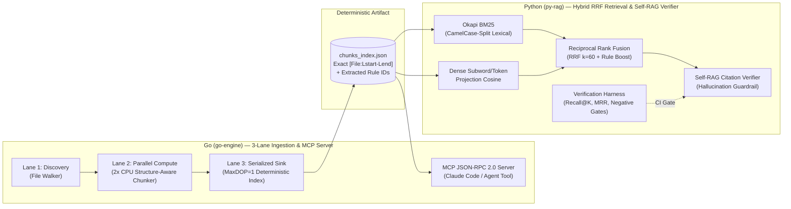

# legacy-lens-rag

**Enterprise Hybrid RAG & MCP Engine for Legacy Codebase Reverse Engineering and `llm-wiki` Governance (Go + Python)**

[](./go-engine)
[](./py-rag)
[](./go-engine/internal/mcp)
[](./py-rag/harnesses/verify_rag_metrics.py)

> **"Don't feed 100,000 lines of undocumented legacy code into an LLM with naive fixed-size text splitting."**
> `legacy-lens-rag` is a production-pattern Hybrid RAG & Model Context Protocol (MCP) reference architecture designed to extract **Ubiquitous Language domain models**, **implicit Business Rules (`BR-*`)**, and **Architecture Decision Records (`ADR-*`)** from large enterprise codebases (C#, Java, SQL) and structured engineering wikis (`llm-wiki`) — with **zero hallucinated citations**.

---

## 1. Why This Architecture Exists (Problem Statement)

In enterprise legacy modernization (e.g., 10+ year-old telecom OSS/NMS or banking core systems), naive tutorial-style RAG fails for three structural reasons:
1. **Naive Chunking Destroys Code Boundaries:** Fixed character/token splitters sever method signatures from doc-comments and split business rule predicates across chunks, destroying line-number provenance.
2. **Dense-Only Vector Search Misses Exact Identifiers:** In legacy codebases, operators and AI agents search for exact rule codes (`BR-POL-002`), method names (`EvaluateCommand`), or threshold constants (`0.035` / `MaxDOP=1`), where pure dense embeddings underperform lexical matching.
3. **Unverified Citations Cause Dangerous Refactoring:** If an LLM hallucinates a business rule or fabricates a source line range, downstream modernization plans become unsafe.

---

## 2. System Architecture (Go + Python Hybrid Pipeline)



### Role Division: Why Go + Python?
- **Go (`go-engine/`):**
  - Implements a **3-Lane Concurrency Pipeline** (inspired by TPL Dataflow Control / Query / Mutation lane isolation): parallel file discovery, `2 × NumCPU` worker pool for **Structure-Aware Chunking** (preserving class/method declarations, doc-comments, and Markdown headers with exact `start_line`–`end_line`), and a single serialized aggregator (`MaxDOP=1`) for deterministic index output.
  - Exposes a zero-dependency **Model Context Protocol (MCP) JSON-RPC 2.0 stdio server** (`lookup_business_rule`) so coding agents (`Claude Code`, `Codex`, `Gemini`) can query business rules directly.
- **Python (`py-rag/`):**
  - Implements **Hybrid Retrieval** combining **Okapi BM25** (with CamelCase identifier sub-tokenization) and **Dense Vector Cosine Similarity**, fused via **Reciprocal Rank Fusion (RRF, $k=60$)** and domain Rule-ID boosting.
  - Enforces a **Self-RAG Hallucination Guardrail (`SelfRagVerifier`)** that rejects any synthesized response lacking valid `[file_path:Lstart-Lend]` provenance or referencing ungrounded Rule IDs.

---

## 3. Verification Harness Output (Evidence Before Assertions)

Following a strict **Verification-Driven AI Engineering** discipline, every retrieval change is gated by `py-rag/harnesses/verify_rag_metrics.py`:

```text
[Go 3-Lane Ingestor] Indexed 4 files into 13 structure-aware chunks in 10 ms -> artifacts/chunks_index.json
==============================================================================
 LEGACY-LENS-RAG : DETERMINISTIC VERIFICATION HARNESS
==============================================================================
[Loaded Index] 13 structure-aware chunks from artifacts/chunks_index.json
  [PASS] Q1 | Rank=1 | RRF=0.0828 (BM25#1, Dense#1) -> [code/CommandPolicyEngine.cs:L30-L90]
  [PASS] Q2 | Rank=1 | RRF=0.0825 (BM25#1, Dense#2) -> [code/CommandPolicyEngine.cs:L1-L29]
  [PASS] Q3 | Rank=1 | RRF=0.0328 (BM25#1, Dense#1) -> [code/RoboAdvisorRebalanceService.java:L1-L17]
  [PASS] Q4 | Rank=1 | RRF=0.0820 (BM25#2, Dense#3) -> [llm-wiki/ADR-001-Three-Lane-Dataflow-Pipeline.md:L1-L7]
  [PASS] Q5 | Rank=1 | RRF=0.0823 (BM25#3, Dense#1) -> [llm-wiki/ADR-002-Headless-VT-Engine-Architecture.md:L1-L7]
------------------------------------------------------------------------------
  [GUARDRAIL TEST 1] Fake File Citation Blocked : True (HALLUCINATED_CITATION: ['[code/NonExistentFile.cs:L1-L50]'] not present in retrieved context.)
  [GUARDRAIL TEST 2] Fake Rule ID Blocked       : True (UNGROUNDED_RULE_ID: 'BR-FAKE-999' does not exist in retrieved chunks.)
------------------------------------------------------------------------------
  METRICS SUMMARY:
    - Recall@1 (Top-1 Exact Hit)    : 100.0% (5/5)
    - Recall@3                      : 100.0% (5/5)
    - Mean Reciprocal Rank (MRR)    : 1.0000
    - Citation Faithfulness Rate    : 100.0% (5/5)
    - Hallucination Guardrail Block : 100.0% (2/2 Blocked)
==============================================================================
  RESULT: ALL RAG VERIFICATION HARNESS GATES PASSED.
```

---

## 4. Quick Start (Zero External API Keys Required)

### Step 1: Run Go Unit Tests & 3-Lane Ingestion Pipeline
```bash
cd go-engine
go test ./... -v
go run ./cmd/legacy-lens -mode=ingest -corpus=../sample-corpus -out=../artifacts/chunks_index.json
```

### Step 2: Run Python Hybrid RAG Verification Harness
```bash
cd ../py-rag
python harnesses/verify_rag_metrics.py
```

### Step 3: Run Go MCP Server for Claude Code / Agent Integration
```bash
cd ../go-engine
go run ./cmd/legacy-lens -mode=mcp -out=../artifacts/chunks_index.json
```

---

## 5. Repository Structure

```text
legacy-lens-rag/
├── README.md                                  # Architecture, verification benchmarks, and usage guide
├── sample-corpus/                             # Representative enterprise legacy code & llm-wiki ADRs
│   ├── code/CommandPolicyEngine.cs            # C# Telecom device command whitelist engine (BR-POL-*)
│   ├── code/RoboAdvisorRebalanceService.java  # Java Financial portfolio drift & VIX circuit breaker (BR-FIN-*)
│   └── llm-wiki/                              # Structured LLM-maintained architecture decision records
│       ├── ADR-001-Three-Lane-Dataflow-Pipeline.md
│       └── ADR-002-Headless-VT-Engine-Architecture.md
├── go-engine/                                 # [Go 1.22+] Concurrent Ingestor, AST/MD Chunker & MCP Server
│   ├── go.mod
│   ├── cmd/legacy-lens/main.go
│   └── internal/
│       ├── chunker/                           # Structure-aware code & markdown chunker + unit tests
│       ├── ingest/                            # 3-Lane goroutine worker pool pipeline
│       └── mcp/                               # Model Context Protocol JSON-RPC 2.0 server
├── py-rag/                                    # [Python 3.12+] Hybrid RRF Retriever & Self-RAG Verifier
│   ├── src/
│   │   ├── retriever.py                       # Okapi BM25 + Dense Vector Projection + RRF Fusion
│   │   └── verifier.py                        # Citation [File:Line] provenance & hallucination guardrail
│   └── harnesses/
│       └── verify_rag_metrics.py              # Deterministic Recall@K, MRR & negative guardrail harness
└── artifacts/
    ├── chunks_index.json                      # Generated deterministic chunk index
    └── rag_verification_report.json           # Generated harness verification metrics
```

---

## Author

**Kyungtae Kang** — Principal AI Systems & Legacy Modernization Architect (28 Years in Enterprise Software)
- GitHub: [github.com/bestguru/legacy-lens-rag](https://github.com/bestguru/legacy-lens-rag) · LinkedIn: [linkedin.com/in/kyungtae-kang](https://www.linkedin.com/in/kyungtae-kang)
