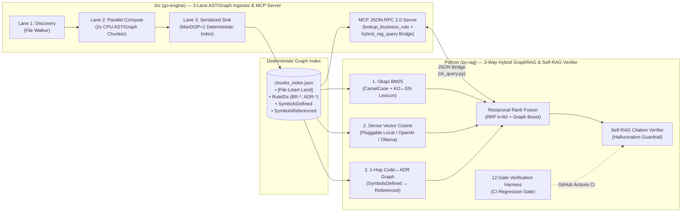

# legacy-lens-rag (v2.0)

**Enterprise 3-Way Hybrid GraphRAG & MCP Engine for Legacy Codebase Reverse Engineering and `llm-wiki` Governance (Go + Python)**

[](https://github.com/bestguru/legacy-lens-rag/actions)
[](./go-engine)
[](./py-rag)
[](./go-engine/internal/mcp)
[](./py-rag/harnesses/verify_rag_metrics.py)

> **"Don't feed 100,000 lines of undocumented legacy code into an LLM with naive fixed-size text splitting."**
> `legacy-lens-rag` v2.0 is a production-pattern **3-Way Hybrid GraphRAG & Model Context Protocol (MCP)** engine designed to extract **Ubiquitous Language domain models**, **implicit Business Rules (`BR-*`)**, and **Architecture Decision Records (`ADR-*`)** from large enterprise codebases (C#, Java, SQL) and structured engineering wikis (`llm-wiki`) — with **zero hallucinated citations** and full **Korean ↔ English cross-lingual retrieval**.

---

## 1. Why Tutorial-Grade RAG Fails on Enterprise Legacy Codebases

In real-world enterprise modernization (10+ year-old telecom OSS/NMS or banking core systems), naive RAG pipelines fail for four structural reasons (documented in [ADR-0001](./docs/adr/ADR-0001-hybrid-go-python-graph-rag.md)):

1. **Naive Chunking Corrupts AST Boundaries & Line Provenance:** Fixed token splitters sever method signatures and XML/Javadoc comments from business rule predicates (`if` branches), destroying `[File:Lstart-Lend]` provenance.
2. **Dense-Only Embeddings Miss Exact Identifiers:** Operators and coding agents query exact rule IDs (`BR-POL-002`), method names (`EvaluateCommand`), or numeric thresholds (`0.035`, `MaxDOP = 1`), where lexical matching (`Okapi BM25`) is mandatory.
3. **Cross-Lingual Query Gap (Korean Question → English Source Code):** Korean enterprise engineers query in Korean (*"운영 장비 설정 모드 진입 시 필요한 권한 레벨과 우회서버 조건은?"*) while the underlying source code and identifiers are in English (`configure terminal`, `OperatorRoleLevel >= 3`, `Mode3_KAM_SSH`).
4. **Isolated Chunks Miss Multi-Hop Dependencies (Code ↔ ADR Graph):** A transport class (`LegacyTelnetSessionManager`) invokes a policy engine (`CommandPolicyEngine`) and is governed by an architectural decision record (`ADR-001`).

---

## 2. v2.0 System Architecture (Go + Python 3-Way Hybrid GraphRAG)



### Key Architectural Highlights (v2.0)
- **[Go] 3-Lane Concurrency Pipeline & AST/Graph Edge Extractor (`go-engine/`):**
  - Mirrors the TPL Dataflow 3-lane architecture: parallel file discovery, `2 × NumCPU` worker pool for AST boundary chunking, and a `MaxDOP=1` serialized sink for deterministic output.
  - Extracts `SymbolsDefined` and `SymbolsReferenced` per chunk to build a **1-Hop Code & ADR Dependency Graph**.
  - Serves an **MCP JSON-RPC 2.0 stdio server** with two tools: `lookup_business_rule` (fast Go lexical/symbol lookup) and `hybrid_rag_query` (live runtime bridge to the Python 3-Way Hybrid GraphRAG engine).
- **[Python] 3-Way Hybrid GraphRAG, Pluggable Embeddings & Cross-Lingual Lexicon (`py-rag/`):**
  - Combines **Okapi BM25** (with CamelCase sub-tokenization and Korean↔English enterprise domain expansion), **Dense Vector Similarity** (via `EmbeddingProvider` protocol supporting zero-key `LocalDeterministicEmbedder` and production `OpenAICompatibleEmbedder`), and **1-Hop GraphRAG Neighbor Boosting** fused via **RRF ($k=60$)**.
  - Enforces a deterministic **Self-RAG Hallucination Guardrail (`SelfRagVerifier`)** that blocks any answer missing valid `[file_path:Lstart-Lend]` citations or referencing ungrounded Rule IDs.

---

## 3. 12-Gate Verification Harness Output (Evidence Before Assertions)

Every commit is verified automatically via GitHub Actions (`.github/workflows/ci.yml`) running `py-rag/harnesses/verify_rag_metrics.py` across **9 Golden Queries (English, Distractor-Disambiguation, and Korean Cross-Lingual)** and **3 Adversarial / GraphRAG Gates**:

```text
[Go 3-Lane Ingestor v2.0] Indexed 6 files into 24 AST/Graph-aware chunks in 9 ms -> artifacts/chunks_index.json
========================================================================================
 LEGACY-LENS-RAG v2.0 : 3-WAY HYBRID GRAPHRAG & SELF-RAG VERIFICATION HARNESS
========================================================================================
[Loaded Index] 24 AST/Graph-aware chunks from artifacts/chunks_index.json
  [PASS] Q1 [EN-Policy]       | Rank=1 | RRF=0.0828 (BM25#1, Dense#1, Graph+0.050) -> [code/CommandPolicyEngine.cs:L30-L90]
  [PASS] Q2 [EN-Blocklist]    | Rank=1 | RRF=0.0905 (BM25#1, Dense#2, Graph+0.058) -> [code/CommandPolicyEngine.cs:L7-L29]
  [PASS] Q3 [EN-Finance]      | Rank=1 | RRF=0.0405 (BM25#1, Dense#2, Graph+0.008) -> [code/RoboAdvisorRebalanceService.java:L7-L17]
  [PASS] Q4 [EN-ADR001]       | Rank=1 | RRF=0.0895 (BM25#3, Dense#4, Graph+0.058) -> [llm-wiki/ADR-001-Three-Lane-Dataflow-Pipeline.md:L1-L7]
  [PASS] Q5 [EN-ADR002]       | Rank=1 | RRF=0.0903 (BM25#3, Dense#1, Graph+0.058) -> [llm-wiki/ADR-002-Headless-VT-Engine-Architecture.md:L1-L7]
  [PASS] Q6 [EN-Bastion]      | Rank=1 | RRF=0.0903 (BM25#2, Dense#2, Graph+0.058) -> [code/LegacyTelnetSessionManager.cs:L8-L18]
  [PASS] Q7 [EN-DapperDB]     | Rank=1 | RRF=0.0903 (BM25#2, Dense#2, Graph+0.058) -> [code/AuditLogBatchWriter.cs:L7-L17]
  [PASS] Q8 [KO-CrossLingual] | Rank=1 | RRF=0.0905 (BM25#1, Dense#2, Graph+0.058) -> [code/CommandPolicyEngine.cs:L30-L90]
  [PASS] Q9 [KO-CrossLingual] | Rank=1 | RRF=0.0900 (BM25#2, Dense#3, Graph+0.058) -> [code/RoboAdvisorRebalanceService.java:L7-L17]
----------------------------------------------------------------------------------------
  [GATE 10: GUARDRAIL] Fake File Citation Blocked : True (HALLUCINATED_CITATION: ['[code/NonExistentFile.cs:L1-L50]'] not present in retrieved context.)
  [GATE 11: GUARDRAIL] Fake Rule ID Blocked       : True (UNGROUNDED_RULE_ID: 'BR-FAKE-999' does not exist in retrieved chunks.)
  [GATE 12: GRAPHRAG ] 1-Hop Code<->ADR Neighbors : True (Linked: ['[code/AuditLogBatchWriter.cs:L7-L17]', '[code/CommandPolicyEngine.cs:L1-L6]', '[code/CommandPolicyEngine.cs:L7-L29]'])
----------------------------------------------------------------------------------------
  METRICS SUMMARY (12 VERIFICATION GATES):
    - Recall@1 (Top-1 Exact Hit)    : 100.0% (9/9)
    - Recall@3                      : 100.0% (9/9)
    - Mean Reciprocal Rank (MRR)    : 1.0000
    - Citation Faithfulness Rate    : 100.0% (9/9)
    - Hallucination Guardrail Block : 100.0% (2/2 Blocked)
    - 1-Hop GraphRAG Edge Link      : PASS
========================================================================================
  RESULT: ALL 12/12 RAG VERIFICATION HARNESS GATES PASSED.
```

---

## 4. Quick Start

```bash
# 1. Run Go AST/GraphRAG unit tests & 3-Lane ingestion pipeline
cd go-engine
go test ./... -v
go run ./cmd/legacy-lens -mode=ingest -corpus=../sample-corpus -out=../artifacts/chunks_index.json

# 2. Run 12-Gate Python Hybrid GraphRAG Verification Harness
cd ../py-rag
python harnesses/verify_rag_metrics.py

# 3. Execute a live Korean Cross-Lingual Query with 1-Hop Graph Neighbors
python src/cli_query.py --index ../artifacts/chunks_index.json --query "운영 장비 설정 모드 진입 시 필요한 권한 레벨과 Bastion 조건은? (BR-POL-002)"
```

---

## 5. Repository Structure

```text
legacy-lens-rag/
├── .github/workflows/ci.yml                   # Automated CI running Go tests + 12-Gate RAG Harness
├── Makefile                                   # Unified build, ingest, verify, and query targets
├── README.md                                  # Architecture, benchmarks, and usage guide
├── docs/adr/
│   └── ADR-0001-hybrid-go-python-graph-rag.md # Architectural rationale for Go+Python GraphRAG
├── sample-corpus/                             # Representative enterprise legacy code & llm-wiki ADRs
│   ├── code/
│   │   ├── CommandPolicyEngine.cs             # C# Telecom device command whitelist engine (BR-POL-*)
│   │   ├── LegacyTelnetSessionManager.cs      # C# Dual-Bastion SSH routing & distractor rules (BR-NET-*)
│   │   ├── AuditLogBatchWriter.cs             # C# Dapper connection factory & batch policy (BR-DB-*)
│   │   └── RoboAdvisorRebalanceService.java   # Java Financial drift & VIX circuit breaker (BR-FIN-*)
│   └── llm-wiki/
│       ├── ADR-001-Three-Lane-Dataflow-Pipeline.md
│       └── ADR-002-Headless-VT-Engine-Architecture.md
├── go-engine/                                 # [Go 1.22+] 3-Lane Ingestor, AST/Graph Chunker & MCP Server
│   ├── go.mod
│   ├── cmd/legacy-lens/main.go
│   └── internal/
│       ├── chunker/                           # AST boundary & GraphRAG edge extractor + unit tests
│       ├── ingest/                            # 3-Lane goroutine worker pool pipeline
│       └── mcp/                               # MCP JSON-RPC 2.0 server with Python RAG bridge
├── py-rag/                                    # [Python 3.12+] 3-Way Hybrid GraphRAG & Self-RAG Verifier
│   ├── src/
│   │   ├── providers.py                       # Pluggable Embedders (Local/OpenAI) & KO<->EN Lexicon
│   │   ├── retriever.py                       # BM25 + Dense + 1-Hop GraphRAG + RRF Fusion
│   │   ├── verifier.py                        # Citation [File:Line] provenance & hallucination guardrail
│   │   └── cli_query.py                       # JSON CLI bridge invoked by Go MCP server
│   └── harnesses/
│       └── verify_rag_metrics.py              # 12-Gate deterministic benchmark & negative test harness
└── artifacts/
    ├── chunks_index.json                      # Generated deterministic AST/Graph chunk index (24 chunks)
    └── rag_verification_report.json           # Generated 12-gate verification metrics report
```

---

## Author

**Kyungtae Kang** — Principal AI Systems & Legacy Modernization Architect (28 Years in Enterprise Software)
- GitHub: [github.com/bestguru/legacy-lens-rag](https://github.com/bestguru/legacy-lens-rag) · LinkedIn: [linkedin.com/in/kyungtae-kang](https://www.linkedin.com/in/kyungtae-kang)
