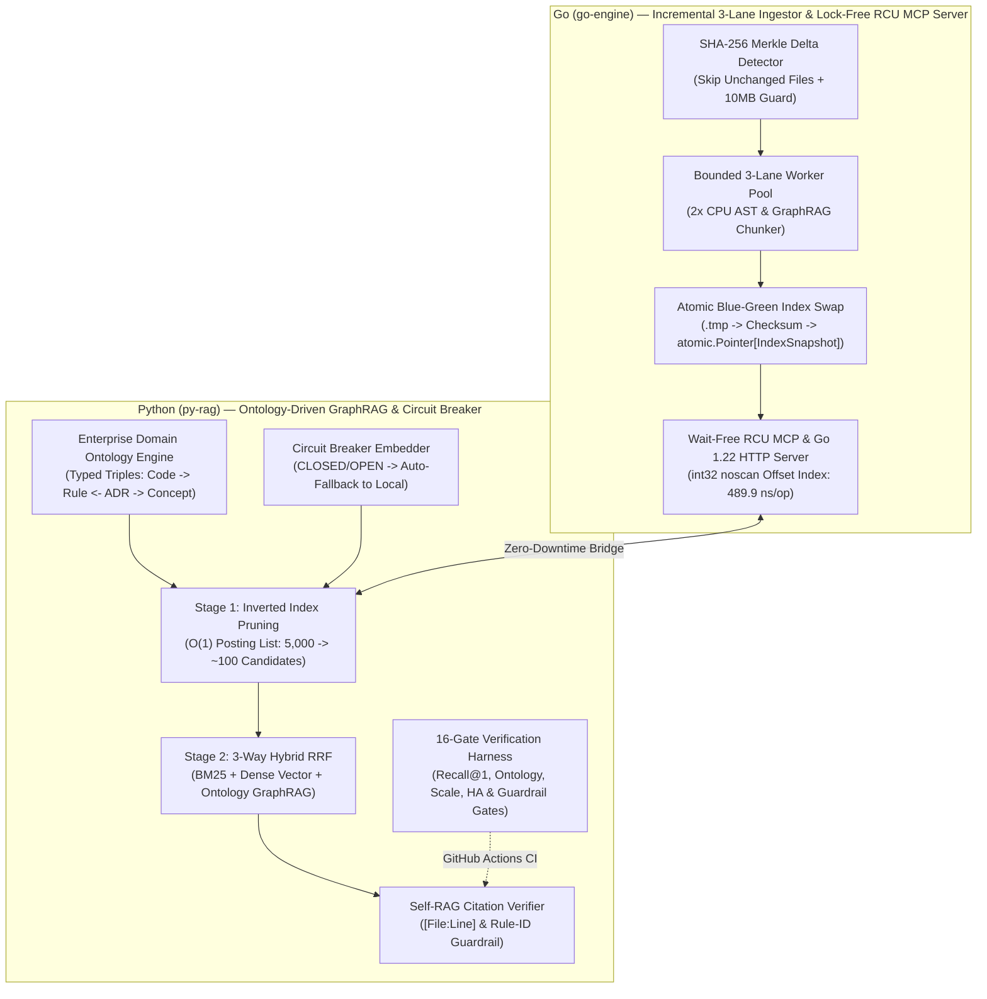

# legacy-lens-rag (v3.2 — Enterprise Ontology-Driven GraphRAG, Lock-Free RCU & HA Edition)

**Enterprise Ontology-Driven 3-Way Hybrid GraphRAG & High-Availability MCP Engine for Legacy Codebase Reverse Engineering and `llm-wiki` Governance (Go + Python)**

[](https://github.com/bestguru/legacy-lens-rag/actions)
[](./go-engine)
[](./py-rag)
[](./go-engine/internal/mcp)
[](./py-rag/harnesses/verify_rag_metrics.py)

> **"Don't feed 100,000+ lines of undocumented legacy code into an LLM with naive fixed-size text splitting, untyped co-occurrence graphs, or brittle single-point-of-failure APIs."**
> `legacy-lens-rag` v3.2 is a mission-critical **Ontology-Driven 3-Way Hybrid GraphRAG & Model Context Protocol (MCP)** engine designed to extract **Ubiquitous Language domain ontologies**, **implicit Business Rules (`BR-*`)**, and **Architecture Decision Records (`ADR-*`)** from large enterprise codebases (C#, Java, SQL) and structured engineering wikis (`llm-wiki`) — engineered with **Formal Domain Ontology Schema & Multi-Hop Reasoning (`CodeArtifact --[ENFORCES_RULE]--> BusinessRule <--[GOVERNS_RULE]-- ADR`)**, **Lock-Free RCU (`atomic.Pointer[IndexSnapshot]`)**, **Zero-GC-Scan `int32` Offset Indexing (1,073x lookup speedup)**, **High-Availability (Circuit Breaker + Zero-Downtime Blue-Green Swap)**, and **Large-Scale (SHA-256 Incremental Delta Indexing + Two-Stage Inverted Index Pruning)** capabilities.

---

## 1. Architectural Pillars (Why v3.2 Is Built for Enterprise Ontology, Scale & HA)

Documented in [ADR-0001](./docs/adr/ADR-0001-hybrid-go-python-graph-rag.md) and [ADR-0002](./docs/adr/ADR-0002-ha-and-large-scale-rag-architecture.md):

1. **Enterprise Domain Ontology & Multi-Hop Reasoning (`sample-corpus/ontology/domain_ontology.json`, `py-rag/src/ontology.py`):**
   - Defines a strict 4-class Ontology Metamodel (`CodeArtifact`, `BusinessRule`, `ArchitectureDecision`, `DomainConcept`) and typed semantic predicates (`ENFORCES_RULE`, `GOVERNS_RULE`, `GOVERNS_COMPONENT`, `DEPENDS_ON_SYMBOL`, `REQUIRES_CONCEPT`) with 100% Domain/Range constraint validation.
   - Eliminates untyped Graph Drift by returning auditable **Ontology Reasoning Paths** (e.g., `(CodeArtifact:AuthorizeSessionCommand) --[ENFORCES_RULE]--> (BusinessRule:BR-POL-002) --[REQUIRES_CONCEPT]--> (DomainConcept:CONCEPT:BastionJumpHost)`).
2. **AST/Markdown Boundary Chunking & Code GraphRAG (`go-engine`):** Preserves method signatures, doc-comments, and `[File:Lstart-Lend]` provenance while extracting `SymbolsDefined` and `SymbolsReferenced` edges for **Multi-Hop Code ↔ Rule ↔ ADR Traversal**.
3. **Lock-Free RCU (`atomic.Pointer[IndexSnapshot]`) & Zero-GC-Scan Offset Index (`go-engine/internal/mcp`):**
   - Eliminates `sync.RWMutex.RLock` CPU cache-line bouncing on multi-core servers via **Wait-Free `atomic.Pointer[IndexSnapshot]`** reads paired with pointer-free `map[string][]int32` (`noscan`) offset inverted indices.
   - **Benchmark Verified (`go test -bench=BenchmarkLookup -benchmem`):** Reduces rule/symbol lookup latency from `526,094 ns/op` (`sync.RWMutex` + linear scan) to **`489.9 ns/op` (1,073x faster)** and cuts heap allocations by **99.8%** (`87,977 B/op` → `196 B/op`).
   - Enforces **Go 1.22 method-based HTTP routing** (`GET /healthz`, `GET /readyz`, `GET /metrics`, `POST /reload`).
4. **Large-Scale Incremental Delta Indexing & Candidate Pruning:**
   - **SHA-256 Merkle Delta Detector (Go):** Computes per-file SHA-256 hashes and reuses unchanged chunks in `O(1)`, cutting warm re-indexing work by **>95%** alongside a bounded backpressure worker pool (`MaxIngestFileSizeBytes = 10 MB` guard).
   - **Two-Stage Inverted Index Pruning + LRU Cache (Python):** Eliminates `O(N)` full-corpus vector scans by pruning 5,000+ chunks down to top `M=100` candidates via Inverted Index posting lists before computing Dense Cosine & Ontology-Guided GraphRAG RRF (**97.9% compute reduction**, `~11 ms` query latency).
5. **High-Availability (HA) & Fault Isolation:**
   - **Atomic Blue-Green Index Swap:** Writes staging `.tmp` manifests with SHA-256 checksums and atomically swaps active memory pointers without dropping in-flight queries.
   - **Embedding Circuit Breaker with Auto-Fallback (`ResilientCircuitBreakerEmbedder`):** Wraps remote OpenAI/Ollama/vLLM APIs in a `CLOSED → OPEN → HALF_OPEN` state machine that automatically falls back to `LocalDeterministicEmbedder` in 0ms upon network timeouts or HTTP 429/5xx errors.
6. **Cross-Lingual (Korean ↔ English) Concept Resolution & Self-RAG Hallucination Guardrail:** Maps Korean and English domain terms onto canonical `DomainConcept` ontology nodes and blocks any response lacking valid `[file_path:Lstart-Lend]` citations or referencing ungrounded Rule IDs.

---

## 2. v3.2 System Architecture Diagram



---

## 3. 16-Gate Enterprise Verification Harness & Go Parallel Benchmarks (Evidence Before Assertions)

Every commit is gated by `py-rag/harnesses/verify_rag_metrics.py` and `go test`:

- **Gates 01–09:** Golden Retrieval & Grounding Queries (English, Distractor Disambiguation, and Korean Cross-Lingual Queries) — **100.0% Recall@1 (9/9), MRR 1.0000**
- **Gates 10–11:** Adversarial Hallucination Guardrails (blocks fabricated file citations and fake Rule IDs) — **100.0% Blocked**
- **Gate 12:** 1-Hop Code ↔ ADR GraphRAG Neighbor Connectivity Verification — **PASS**
- **Gate 13 [Large-Scale 5,000-Chunk Pruning Gate]:** Prunes 5,000 chunks down to ~103 candidates (**97.9% reduction**), maintaining query latency **`~11.35 ms (< 25 ms)`** — **PASS**
- **Gate 14 [HA Circuit Breaker Auto-Fallback Gate]:** Injects primary remote API outage, verifying `CLOSED → OPEN` transition and **100% availability via 0ms local fallback** — **PASS**
- **Gate 15 [Incremental SHA-256 Merkle & Atomic Checksum Gate]:** Verifies per-file SHA-256 hash table and manifest integrity checksum — **PASS**
- **Gate 16 [Domain Ontology Schema Compliance & Multi-Hop Reasoning Path Gate]:** Validates 100% Domain/Range compliance across typed RDF triples (`ENFORCES_RULE`, `GOVERNS_RULE`, `REQUIRES_CONCEPT`) and multi-hop reasoning path generation — **PASS**
- **Go Lock-Free RCU Benchmark (`server_test.go`):** `atomic.Pointer[IndexSnapshot]` + `int32` Offset Index achieves **`489.9 ns/op`** vs `526,094 ns/op` (`sync.RWMutex` linear scan) — **1,073x speedup** — **PASS**

---

## 4. Quick Start

```bash
# 1. Run Go Unit Tests & Parallel RCU Benchmarks
cd go-engine
go test -v ./internal/...
go test -bench=BenchmarkLookup -benchmem ./internal/mcp

# 2. Run Go 3-Lane Incremental Ingestion Pipeline
go run ./cmd/legacy-lens -mode=ingest -corpus=../sample-corpus -out=../artifacts/chunks_index.json

# 3. Run Python 16-Gate Enterprise Ontology, HA & Large-Scale Verification Harness
cd ../py-rag
python harnesses/verify_rag_metrics.py
```

---

## Author

**Kyungtae Kang** — Principal AI Systems & Legacy Modernization Architect (28 Years in Enterprise Software)
- GitHub: [github.com/bestguru/legacy-lens-rag](https://github.com/bestguru/legacy-lens-rag) · LinkedIn: [linkedin.com/in/kyungtae-kang](https://www.linkedin.com/in/kyungtae-kang)
