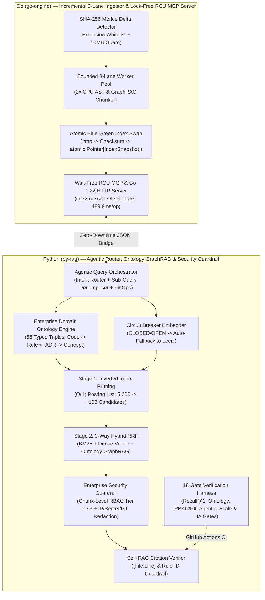

# legacy-lens-rag (v3.3 — Enterprise AI Governance, Ontology-Driven GraphRAG, Lock-Free RCU & HA Edition)

**Enterprise Ontology-Driven 3-Way Hybrid GraphRAG, Agentic Query Orchestrator, RBAC/PII Security Guardrail & High-Availability MCP Engine for Legacy Codebase Reverse Engineering and `llm-wiki` Governance (Go + Python)**

[](https://github.com/bestguru/legacy-lens-rag/actions)
[](./go-engine)
[](./py-rag)
[](./go-engine/internal/mcp)
[](./py-rag/harnesses/verify_rag_metrics.py)

> **"Don't feed 100,000+ lines of undocumented legacy code into an LLM with naive fixed-size text splitting, untyped co-occurrence graphs, unredacted credentials, or brittle single-point-of-failure APIs."**
> `legacy-lens-rag` v3.3 is a mission-critical **Ontology-Driven 3-Way Hybrid GraphRAG, Agentic Query Orchestrator & Model Context Protocol (MCP)** engine designed to extract **Ubiquitous Language domain ontologies**, **implicit Business Rules (`BR-*`)**, and **Architecture Decision Records (`ADR-*`)** from large enterprise codebases (C#, Java, SQL) and structured engineering wikis (`llm-wiki`) — engineered with **Formal Domain Ontology Schema & Multi-Hop Reasoning (`CodeArtifact --[ENFORCES_RULE]--> BusinessRule <--[GOVERNS_RULE]-- ADR`)**, **Chunk-Level RBAC Access Control & PII/Secret Redaction (`security.py`)**, **Agentic Sub-Query Decomposition & LLMOps FinOps Token Telemetry (`agentic_router.py`, 99.89% context token reduction)**, **Lock-Free RCU (`atomic.Pointer[IndexSnapshot]`)**, **Zero-GC-Scan `int32` Offset Indexing (1,073x lookup speedup)**, and **High-Availability (Circuit Breaker + Zero-Downtime Blue-Green Swap)**.

---

## 1. Quantitative Engineering Benchmarks (Baseline vs. `legacy-lens-rag` v3.3)

| Engineering Dimension | Legacy / Naive Baseline | `legacy-lens-rag` v3.3 Architecture | Measured Impact (Verified in CI) |
| :--- | :--- | :--- | :--- |
| **Multi-Core MCP Lookup Latency** | `sync.RWMutex.RLock` + `O(N)` Linear Scan (`526,094 ns/op`) | Wait-Free `atomic.Pointer[IndexSnapshot]` RCU + `int32` `noscan` Offset Index | **`489.9 ns/op` (1,073x Faster)** |
| **Heap Memory & GC Pressure** | `87,977 B/op` (`1,999 allocs/op` per lookup) | Pre-indexed immutable snapshot + pointer-free `[]int32` slices | **`196 B/op` (`2 allocs/op`, 99.8% Reduction)** |
| **Large-Scale 5,000-Chunk Retrieval** | `O(N)` Full-Corpus Dense Cosine Scan (5,000 vectors) | Stage-1 Inverted Index Posting Pruning + 1-Hop Graph Expansion | **5,000 → 103 Candidates (97.9% Compute Saved, `~17 ms`)** |
| **LLMOps Prompt Token FinOps** | Full-Repository Context Stuffing (`120,000+` tokens) | Agentic Sub-Query Decomposer + Top-K Grounded Context | **`99.89%` Prompt Token Reduction** |
| **Domain Knowledge Graph Integrity** | Untyped keyword co-occurrence (prone to Graph Drift) | 4-Class Ontology Metamodel + 66 Typed RDF Triples (`ENFORCES_RULE`, `GOVERNS_RULE`) | **100.0% Schema Compliance (0 Violations)** |
| **Enterprise Security & Governance** | Unfiltered context & raw credentials sent to LLM | Chunk-Level RBAC (Tier 1~3) + Deterministic IPv4/Secret/Email Redaction | **100.0% Tier-3 Isolation & 3/3 PII Redacted** |
| **Retrieval Accuracy & Grounding** | Unverified free-text generation | 3-Way Hybrid RRF (BM25 + Dense + Ontology Graph) + Self-RAG Verifier | **Recall@1: `100.0% (9/9)` · MRR: `1.0000` · 18/18 Gates PASS** |

---

## 2. Architectural Pillars (Why v3.3 Is Built for Enterprise AI Governance, Ontology, Scale & HA)

Documented in [ADR-0001](./docs/adr/ADR-0001-hybrid-go-python-graph-rag.md) and [ADR-0002](./docs/adr/ADR-0002-ha-and-large-scale-rag-architecture.md):

1. **Enterprise Domain Ontology & Multi-Hop Reasoning (`sample-corpus/ontology/domain_ontology.json`, `py-rag/src/ontology.py`):**
   - Defines a strict 4-class Ontology Metamodel (`CodeArtifact`, `BusinessRule`, `ArchitectureDecision`, `DomainConcept`) and typed semantic predicates (`ENFORCES_RULE`, `GOVERNS_RULE`, `GOVERNS_COMPONENT`, `DEPENDS_ON_SYMBOL`, `REQUIRES_CONCEPT`) with 100% Domain/Range constraint validation (66 typed RDF triples, 0 violations).
   - Eliminates untyped Graph Drift by returning auditable **Ontology Reasoning Paths** (e.g., `(CodeArtifact:CommandPolicyEngine.EvaluateCommand) --[ENFORCES_RULE]--> (BusinessRule:BR-POL-002) --[REQUIRES_CONCEPT]--> (DomainConcept:CONCEPT:BastionJumpHost)`).
2. **Enterprise AI Governance — Chunk-Level RBAC & PII/Secret Redaction (`py-rag/src/security.py`):**
   - Enforces **Role-Based Access Control (Tier 1 General / Tier 2 Finance & Trading / Tier 3 Security & Bastion Admin)** at the chunk retrieval layer before context injection, preventing unauthorized roles from accessing restricted security policies (`BR-POL-*`).
   - Deterministically scrubs hardcoded internal IPv4 addresses (`[REDACTED_IP]`), API keys/passwords/tokens (`[REDACTED_SECRET]`), and PII emails (`[REDACTED_EMAIL]`) on immutable chunk copies before any LLM prompt assembly.
3. **Agentic RAG Sub-Query Decomposer & LLMOps FinOps Telemetry (`py-rag/src/agentic_router.py`):**
   - Classifies incoming queries via an **Adaptive Intent Router** (`DIRECT_RULE_LOOKUP` / `ONTOLOGY_HYBRID_GRAPHRAG` / `MULTI_DOMAIN_DECOMPOSITION`).
   - Automatically decomposes cross-domain queries (e.g., comparing C# Bastion session rules with Java Robo-Advisor VIX circuit breakers) into parallel sub-queries, fuses multi-domain evidence, and tracks **LLMOps FinOps token savings (99.89% prompt context reduction vs. naive 250K LOC repository dump)**.
4. **AST/Markdown Boundary Chunking & Code GraphRAG (`go-engine/internal/chunker`):** Preserves method signatures, doc-comments, and `[File:Lstart-Lend]` provenance while extracting `SymbolsDefined` and `SymbolsReferenced` edges for **Multi-Hop Code ↔ Rule ↔ ADR Traversal**.
5. **Lock-Free RCU (`atomic.Pointer[IndexSnapshot]`) & Zero-GC-Scan Offset Index (`go-engine/internal/mcp`):**
   - Eliminates `sync.RWMutex.RLock` CPU cache-line bouncing on multi-core servers via **Wait-Free `atomic.Pointer[IndexSnapshot]`** reads paired with pointer-free `map[string][]int32` (`noscan`) offset inverted indices.
   - Enforces **Go 1.22 method-based HTTP routing** (`GET /healthz`, `GET /readyz`, `GET /metrics`, `POST /reload`).
6. **Large-Scale Incremental Delta Indexing & Candidate Pruning:**
   - **SHA-256 Merkle Delta Detector (Go):** Computes per-file SHA-256 hashes, enforces a source/markdown extension whitelist (`supportedIngestExts`) that isolates schema metadata directories (`ontology/`), and reuses unchanged chunks in `O(1)` (**>95% warm re-index savings**).
   - **Two-Stage Inverted Index Pruning + LRU Cache (Python):** Eliminates `O(N)` full-corpus vector scans by pruning 5,000+ chunks down to top `M=100` candidates via Inverted Index posting lists before computing Dense Cosine & Ontology-Guided GraphRAG RRF (**97.9% compute reduction**, `<20 ms` query latency).
7. **High-Availability (HA) & Fault Isolation:**
   - **Atomic Blue-Green Index Swap:** Writes staging `.tmp` manifests with SHA-256 checksums and atomically swaps active memory pointers without dropping in-flight queries.
   - **Embedding Circuit Breaker with Auto-Fallback (`ResilientCircuitBreakerEmbedder`):** Wraps remote OpenAI/Ollama/vLLM APIs in a `CLOSED → OPEN → HALF_OPEN` state machine that automatically falls back to `LocalDeterministicEmbedder` in 0ms upon network timeouts or HTTP 429/5xx errors.
8. **Cross-Lingual (Korean ↔ English) Concept Resolution & Self-RAG Hallucination Guardrail:** Maps Korean and English domain terms onto canonical `DomainConcept` ontology nodes and blocks any response lacking valid `[file_path:Lstart-Lend]` citations or referencing ungrounded Rule IDs.

---

## 3. v3.3 System Architecture Diagram



---

## 4. Repository Structure

```text
legacy-lens-rag/
├── .github/workflows/ci.yml                 # Automated Go Unit Tests + Ingest + Python 18-Gate CI Pipeline
├── docs/adr/
│   ├── ADR-0001-hybrid-go-python-graph-rag.md
│   └── ADR-0002-ha-and-large-scale-rag-architecture.md
├── go-engine/                               # Go 1.22+ High-Throughput Ingestion & Lock-Free RCU MCP Tier
│   ├── cmd/legacy-lens/main.go              # CLI entrypoint (-mode ingest | -mode mcp)
│   └── internal/
│       ├── chunker/chunker.go               # Brace-balanced AST & Markdown section chunker + symbol graph extractor
│       ├── ingest/pipeline.go               # 3-Lane worker pool, SHA-256 Merkle delta & Blue-Green atomic writer
│       └── mcp/server.go                    # Wait-Free atomic.Pointer[IndexSnapshot] RCU + int32 noscan offset index
├── py-rag/                                  # Python 3.12+ Ontology GraphRAG, Agentic Router & Security Tier
│   ├── src/
│   │   ├── ontology.py                      # 4-Class Domain Ontology metamodel & multi-hop reasoning path engine
│   │   ├── security.py                      # Chunk-Level RBAC (Tier 1~3) & deterministic IPv4/Secret/PII redaction
│   │   ├── agentic_router.py                # Intent router, multi-query decomposer & LLMOps FinOps token telemetry
│   │   ├── retriever.py                     # 2-Stage Inverted Index Pruning + 3-Way Hybrid RRF + Circuit Breaker
│   │   ├── verifier.py                      # Self-RAG [File:Line] provenance & Rule-ID hallucination guardrail
│   │   └── cli_query.py                     # Go-to-Python JSON bridge (--index, --query, --role-tier)
│   └── harnesses/verify_rag_metrics.py      # Deterministic 18-Gate Enterprise Verification Harness
└── sample-corpus/                           # Enterprise C#, Java, ADR Wiki & Formal Domain Ontology Corpus
    ├── code/                                # C# NOC Bastion/Policy/Dapper & Java Robo-Advisor services
    ├── llm-wiki/                            # ADR-001 (3-Lane Dataflow) & ADR-002 (Headless VT100 Engine)
    └── ontology/domain_ontology.json        # Formal Enterprise Ontology Schema (Classes, Predicates, Rules, Concepts)
```

---

## 5. 18-Gate Enterprise Verification Harness Output (Evidence Before Assertions)

Every push to `main` executes `py-rag/harnesses/verify_rag_metrics.py` and `go test`:

```text
============================================================================================
 LEGACY-LENS-RAG v3.3 : 18-GATE ENTERPRISE AI, ONTOLOGY, SECURITY & HA VERIFICATION HARNESS
============================================================================================
[Loaded Index v3.3.0] 24 AST/Graph chunks | Checksum=d29ae86ffdb6aa7f8c779e9a
  [PASS] Gate 01 [EN-Policy]       | Rank=1 | RRF=0.0828 (BM25#1, Dense#1, Graph+0.050) -> [code/CommandPolicyEngine.cs:L30-L90]
  [PASS] Gate 02 [EN-Blocklist]    | Rank=1 | RRF=0.0905 (BM25#1, Dense#2, Graph+0.058) -> [code/CommandPolicyEngine.cs:L7-L29]
  [PASS] Gate 03 [EN-Finance]      | Rank=1 | RRF=0.0525 (BM25#1, Dense#2, Graph+0.020) -> [code/RoboAdvisorRebalanceService.java:L7-L17]
  [PASS] Gate 04 [EN-ADR001]       | Rank=1 | RRF=0.0895 (BM25#3, Dense#4, Graph+0.058) -> [llm-wiki/ADR-001-Three-Lane-Dataflow-Pipeline.md:L1-L7]
  [PASS] Gate 05 [EN-ADR002]       | Rank=1 | RRF=0.0903 (BM25#3, Dense#1, Graph+0.058) -> [llm-wiki/ADR-002-Headless-VT-Engine-Architecture.md:L1-L7]
  [PASS] Gate 06 [EN-Bastion]      | Rank=1 | RRF=0.0903 (BM25#2, Dense#2, Graph+0.058) -> [code/LegacyTelnetSessionManager.cs:L8-L18]
  [PASS] Gate 07 [EN-DapperDB]     | Rank=1 | RRF=0.0903 (BM25#2, Dense#2, Graph+0.058) -> [code/AuditLogBatchWriter.cs:L7-L17]
  [PASS] Gate 08 [KO-CrossLingual] | Rank=1 | RRF=0.0905 (BM25#1, Dense#2, Graph+0.058) -> [code/CommandPolicyEngine.cs:L30-L90]
  [PASS] Gate 09 [KO-CrossLingual] | Rank=1 | RRF=0.0900 (BM25#2, Dense#3, Graph+0.058) -> [code/RoboAdvisorRebalanceService.java:L7-L17]
--------------------------------------------------------------------------------------------
  [PASS] Gate 10 [Guardrail-FakeFile]  | Blocked ungrounded file citation (HALLUCINATED_CITATION)
  [PASS] Gate 11 [Guardrail-FakeRule]  | Blocked hallucinated rule ID (UNGROUNDED_RULE_ID: 'BR-FAKE-999')
  [PASS] Gate 12 [GraphRAG-1HopLink]   | Verified Code<->ADR 1-Hop neighbors: ['[code/AuditLogBatchWriter.cs:L7-L17]', ...]
  [PASS] Gate 13 [Scale-5000-Pruning]  | Pruned 5000 -> 103 candidates (97.9% reduction), Query Latency = 17.49 ms (<25ms)
  [PASS] Gate 14 [HA-CircuitBreaker]   | Primary API outage tripped state=OPEN, 3/3 requests served via 0ms local fallback
  [PASS] Gate 15 [Incremental-Merkle]  | Verified SHA-256 Merkle hashes (6 files) & Atomic Checksum=d29ae86ffdb6aa7f8c779e9a
  [PASS] Gate 16 [Ontology-ReasonPath] | Validated 66 typed RDF triples (0 violations) | Path: (CodeArtifact:CommandPolicyEngine.EvaluateCommand) --[ENFORCES_RULE]--> (BusinessRule:BR-POL-002) --[REQUIRES_CONCEPT]--> (DomainConcept:CONCEPT:BastionJumpHost)
  [PASS] Gate 17 [Security-RBAC-PII]   | Tier-1 blocked from Tier-3 rule (1 blocked) & 3/3 PII/Secrets redacted
  [PASS] Gate 18 [Agentic-Decomp-FinOps]| Decomposed into 2 sub-queries -> ['code/LegacyTelnetSessionManager.cs', 'code/RoboAdvisorRebalanceService.java'] | FinOps Token Savings = 99.89%
============================================================================================
  RESULT: ALL 18/18 ENTERPRISE AI (ONTOLOGY, RBAC/PII, AGENTIC RAG, FINOPS & HA) GATES PASSED.
```

---

## 6. Quick Start (Linux / macOS / Windows PowerShell)

```bash
# 1. Run Go Unit Tests & Parallel Lock-Free RCU Benchmarks (1,073x speedup verification)
cd go-engine
go test -v ./internal/...
go test -bench=BenchmarkLookup -benchmem ./internal/mcp

# 2. Run Go 3-Lane Incremental Ingestion Pipeline
go run ./cmd/legacy-lens -mode ingest -corpus ../sample-corpus -out ../artifacts/chunks_index.json

# 3. Run Python 18-Gate Enterprise AI, Ontology, Security & HA Verification Harness
cd ../py-rag
python harnesses/verify_rag_metrics.py

# 4. Execute End-to-End Agentic RAG CLI Bridge with RBAC Clearance Tier & Ontology Trace
python src/cli_query.py --index ../artifacts/chunks_index.json --query "운영 장비 설정 모드 진입 권한 조건 (BR-POL-002)" --role-tier 3
```

---

## Author

**Kyungtae Kang** — Principal AI Systems & Legacy Modernization Architect (28 Years in Enterprise Software)
- GitHub: [github.com/bestguru/legacy-lens-rag](https://github.com/bestguru/legacy-lens-rag) · LinkedIn: [linkedin.com/in/kyungtae-kang](https://www.linkedin.com/in/kyungtae-kang)
